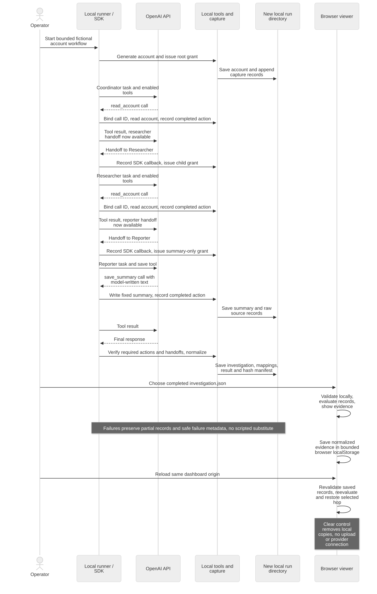
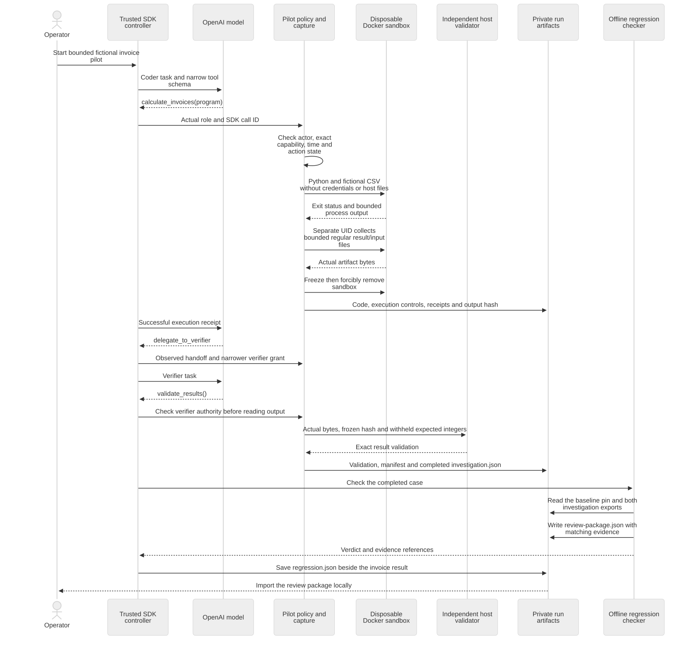

# Architecture

## Current system

The local viewer loads native HTML/CSS/JavaScript modules from a Python static server on IPv4 loopback. It evaluates fixed fictional examples or a manually selected version 1 completed-record export. File API intake is normalized and saved in origin-scoped browser localStorage across reloads. There is no data upload, writable backend, server database, cookie, authenticated session or provider connection from the browser.

The optional Python SDK runner produces an importable `investigation.json`. The separate Node experiment produces raw records and bare `normalized.json` for offline evaluation; it has no browser-import adapter. Neither process is launched by the dashboard.

## C4 views

The [diagram guide](docs/architecture/README.md) links editable sources and rendering instructions. C4 containers here are applications/data stores, not Docker units or deployed services.

| Source | Owns |
| --- | --- |
| `src/index.html`, `src/styles.css` | Semantic shell, native chooser and responsive presentation |
| `src/app.js` | Chain, hop and run-pair selection, hash navigation, import state and escaped evidence rendering |
| `src/comparison.mjs` | Deterministic alignment, comparison and regression classification of two normalized runs |
| `src/import.mjs` | Bounded version 1 intake, normalization and imported-chain merge |
| `src/storage.mjs` | Versioned, bounded browser-local imports and workflow baseline pins |
| `scripts/regression.mjs` | Offline baseline pinning and regression reports using the viewer's normalization and comparison rules |
| `src/review.mjs`, `src/review-view.mjs` | Report and package intake, local downloads, bounded inbox storage, review decisions and follow-up verification |
| `scripts/alpha-rehearsal.mjs` | Offline generation of fictional reviewer and facilitator materials with the regression checker |
| `src/fixtures.mjs` | Three fixed fictional investigations |
| `src/evaluator.mjs` | Pure deterministic retrospective authority checks |
| `scripts/serve.py` | Loopback static delivery, Host checks and public asset allowlist |
| `integrations/openai-agents/` | Optional actual model-agent execution, capture and export |
| `experiments/controlled-capture/` | Separate scripted local capture and negative branches |
| `experiments/sandbox-agent/` | Optional model-written invoice code, isolated Docker execution, runtime pilot policy and independent output validation |

## Records and evaluation

An export declares `schemaVersion: 1` and a `chain`; producers may add provenance. The viewer normalizes the chain and labels its source as an unverified claim rather than authenticating producer metadata. Chains identify a principal and root grant. Completed events identify actor, parent event, authority, exact action/resource and action time. Grants identify issuer, subject, principal, parent grant, capability pairs, validity window and delegation permission. Optional tool evidence includes call ID, tool and artifact hash. `src/import.mjs` is the exact field/limit contract.

Inputs are bounded to 1 MiB, 200 events, 200 grants and 100 capabilities per grant, with identifier/field-length limits. Duplicate IDs, malformed shapes, unsupported IDs, built-in `CH-` chain IDs and incomplete actions are rejected recoverably. Semantic gaps that pass intake remain evaluator evidence gaps. Imported strings are rendered literally and timestamps use a supported numeric ISO form.

`evaluateChain` independently limits direct callers to 200 events/grants, 100 capabilities per grant and the importer's security-field sizes. Only action/resource fields enter compared capability evidence. It charges a deterministic 50,000-unit budget for indexing, event/grant ancestry and capability validation/comparison. Finding identity uses nested maps/sets rather than full-array scans. At most 1,000 ordinary findings plus a reserved global `EVALUATION_LIMIT` finding are returned. On exhaustion, proven violations are retained, completeness is incomplete and all other displayable events are unknown. A limit is a partial assessment, not rejection of the supplied evidence or a clean authorization conclusion. The controller serializes repeated compared evidence only when its details are opened. These bounds control local work without adding a worker or changing the loopback asset boundary.

The pure evaluator reports `valid`, `violation` or `unknown`, completeness and per-event findings. The UI uses Within scope, Violation and Unverifiable. Event and grant ancestry are checked independently; record order never establishes lineage. Child authority must preserve identity/principal continuity, exact capabilities, delegation permission and narrower lifetimes. Each action must fall inside every ancestor's inclusive-start/exclusive-expiry window. Wildcards and prefixes have no special meaning. Invalid, missing, ambiguous or cyclic evidence cannot support a clean result. A separately provable violation remains visible beside other gaps. Results use recorded action time, independently of today's clock.

The comparison uses both runs' existing evaluations. It aligns events by exact record ID, then by unique actor and action/resource pair, then by unique remaining actor. Grants align by exact ID, then by unique subject/issuer/principal, then by unique remaining subject. Unmatched records appear on one side with their evidence, since an unmatched grant may be absent from the capture or lack a unique counterpart. The comparison uses recorded identities and never infers correspondence from array position.

Permissions compare exact capability pairs, delegation, principal, lineage and grant duration. For the known sandbox pilot, only each run's own execution and result targets are treated as equivalent across captures. Raw resource names, dates, call IDs and artifact hashes remain available in expanded records. The view compares recorded actions and parent references, evidence fields, referenced grant presence, evaluator outcomes and finding-code counts. It uses the existing import limits and renders raw records on expansion.

Regression checks use the selected workflow's pinned baseline, the same aligned differences, and the candidate's evaluator result. A proved regression takes precedence over an evidence gap, and both types of reasons are shown when present. A candidate violation or widening of a matched grant flags a regression, as does a changed matched action/resource pair. Unmatched records, changes in authority lineage, and loss of previously supplied evidence require review. Optional evidence is required where the baseline supplied it. A change in call ID or a valid hash alone does not affect the verdict. Reasons link to the compared row or the candidate hop.

## Optional actual-agent workflow

The caller-owned Python SDK loop runs Coordinator → Researcher → Reporter. Each role completes one fixed local tool action. Handoffs become available only after the current role finishes its action; repeated role tools are disabled. Tools accept no arbitrary file paths. The first two roles read generated fictional account data; Reporter writes a model-generated summary to a fixed file. Root/research grants include read and summary-write authority; the reporter grant narrows to summary write without further delegation.

SDK callbacks and tools bind model call IDs, role, parent action, local grant, source line and artifact hash. These are application-issued bindings, not cryptographic identities or external IAM. The runner reads ignored project-root `.env.local` and exchanges fictional tasks/results with OpenAI over HTTPS. Trace export is disabled and response storage requested off. Limits are ten turns/requests, 1200 output tokens per request, a 35-second provider timeout and 150 seconds overall, with no provider retries. These are execution bounds, not a monetary price.

A new run directory stores account data, capture, normalized investigation, mappings, summary, result and a hash manifest. Its parent must exist; existing output directories are refused. Failed runs retain safe failure metadata and partial capture, with no scripted substitute. Hashes establish byte correspondence, not authenticity or complete capture. Setup and exact versions are in the [integration guide](integrations/openai-agents/README.md).

## Optional sandboxed coding pilot

This path has been exercised: three live Coder → Verifier runs passed exact
fictional-invoice output checks. Their saved programs also passed the final
hardened executor without more provider calls. The [validation report](docs/SANDBOX_VALIDATION.md)
records observed outcomes, the hardening chronology, real-container negative
controls and the limits of that evidence. The diagrams describe the current
implementation; the report identifies what was actually tested.

The separately invoked pilot retains the caller-owned Agents SDK loop and model.
Coder calls one fixed invoice-calculation tool with Python text, then hands off to
Verifier, whose fixed tool checks downloaded result bytes against withheld expected
integers. These are actual SDK role/tool/handoff bindings. A host-owned pilot policy
checks actor, exact action/resource, validity, call ID and completed-role state before
each action. It is a narrow execution gateway, separate from the retrospective viewer.

Every execution creates a disposable Docker container with no host mounts, ports,
network, API key or repository; read-only root, non-root job, dropped capabilities,
no-new-privileges and explicit CPU/memory/process/output/time/file limits apply. A
4 MiB tmpfs holds fictional input, generated code and output. A separate non-root
collector UID reads only bounded regular result/input files; the host never extracts
the archive. The original input must be unchanged, and the actual result must pass
integer/schema/hash checks. Containers are removed after collection or failure.

Completed actions use the existing version 1 envelope and evaluate independently.
Denied attempts, execution failures, business-result grading and capture/hash checks
have separate receipts; they are not represented as completed actions. Missing or
over-granted evidence is mutated only in explicitly derived offline tests. No general
grant service, authenticated principal, signed evidence or sandbox-escape resistance
is established. See the [pilot guide](experiments/sandbox-agent/README.md) for exact
limits, repeatability and cleanup boundaries.

After the pilot writes a completed investigation and its manifest, the host runs the
offline Node checker. The checker reads a separately pinned baseline and the completed
export, reuses the viewer's fingerprint, evaluator and comparison rules, and returns a
verdict with affected event or grant IDs. The checker can write `review-package.json`
using the same in-memory evidence it checked. The pilot saves `regression.json`
separately and records package creation in the case result. The evidence manifest
covers the capture files written before the check. Missing, altered or unusable
inputs require review. The checker reads local files and uses no model or Docker
calls. Browser pins and command-line pins are managed separately.

The browser can also check a selected invoice case folder in the regression inbox.
It hashes the original bytes of six allowlisted files against the supplied manifest.
Authority reuses the delegation evaluator. Output checks the totals against the
expected values and validation receipt, and binds the output digest to both
completed actions. Execution reports completion, exit code, input preservation,
cleanup and attempt counts from matching receipts. Each lane reports its own
result. The importer reads only allowlisted receipt files. The manifest is unsigned.

The inbox can compare the selected folder's matching investigation against the
exact saved workflow pin. Saving records the report, baseline and candidate,
relevant manifest digests, and original receipt bytes in one bounded inbox write.
The receipt snapshot fingerprint distinguishes copies with the same run ID and
different files. Opening the entry recomputes the comparison from the saved
runs and verifies the saved receipt bytes. Review downloads carry the existing
delegation evidence and case fields.

## Trust and recovery

The static server permits only `/`, `/index.html`, `/styles.css`, `/app.js`, `/fixtures.mjs`, `/evaluator.mjs`, `/import.mjs`, `/storage.mjs`, `/comparison.mjs`, `/review.mjs` and `/review-view.mjs`. It rejects writes, unexpected Hosts and repository paths. Its content policy blocks outbound browser connections. Loopback is a development boundary, not authentication. Run artifacts and credentials are not served.

Imports are stored under `adcp.investigations.v1` as versioned normalized envelopes, with a 20-run / 2 MiB UTF-8 serialized collection limit in addition to per-import limits. Each saved envelope passes intake again on startup and findings are recomputed with the current evaluator before hash selection, so a chain/hop URL can reopen its saved evidence. Findings are never trusted from storage. Reimport replaces the same chain ID; writes merge against the latest saved collection to preserve imports from other tabs. Writes are synchronous but do not provide transactional cross-tab coordination.

Users name workflows explicitly. A separate, versioned browser store holds up to 20 workflow names, run IDs and SHA-256 fingerprints of the selected normalized runs, capped at 12 KiB. The viewer checks a pin against the loaded record before reporting a regression verdict. Reimporting changed evidence under the same run ID cannot silently move the baseline. Clear imported runs leaves pins available for reimport of the original records, and users can remove pins independently. A fingerprint identifies the saved record and does not authenticate its producer. Reload the view to pick up records imported in another tab.

The review inbox stores up to 20 reports and 2 MiB total under `adcp.regression-reviews.v1`. Each item has the normalized report, optional matching evidence snapshots, a note and a reviewed flag. Attachments must match both run ID and fingerprint. Opening an item rechecks the snapshots and recomputes findings with the current evaluator when both exports qualify. The recorded verdict and current result remain distinct. Evidence drill-down stays within the saved snapshots, even when a normal run import with the same ID changes. Report input does not supply navigation targets. Reimporting the same report preserves its note and matching snapshots, and updates save the report, evidence and note together under one key. The inbox has its own removal control.

A portable package is a version 1 JSON document capped at 2 MiB. It wraps the normalized report, optional matching version 1 investigation envelopes and an optional note. Imports use the same fingerprint checks as separate files. An altered attachment is excluded and marked as mismatched. Exports use a browser-local download, omit the note by default and leave review completion local to each inbox. An included note seeds a newly imported item. Existing local reviews take precedence on reimport.

An inbox case can save a decision with its reason and one current follow-up. The follow-up must reference the original baseline ID and fingerprint and provide matching baseline and candidate exports. Its candidate must have a distinct run ID. The inbox stores the follow-up report and candidate snapshot and reuses the original baseline snapshot. A case can resolve only when the original check still flags the case, both evidence pairs verify, and the reported and recomputed follow-up verdicts pass. Resolution points to the saved follow-up and is verified again when the case opens.

A version 1 `adcp-review-case` file uses the same 2 MiB limit and adds the decision,
matching follow-up report and candidate, and a closure fingerprint when verified
on export. It binds the original report, decision, and follow-up. Import derives
local report IDs and rechecks both evidence pairs before
restoring closure. A case import writes once and preserves any existing local
decision and follow-up. Fingerprints let the browser check the supplied records
against their reports. They provide no proof of authorship.

Unreadable collections leave examples usable; malformed individual records are skipped with a visible warning and are never silently overwritten on save. Capacity, quota or denied-storage failures leave the new import available only in the current tab with a warning. No run is automatically evicted. **Clear imported runs** removes only this application key and the current tab's imports; other open tabs retain loaded copies until reload. Original export files remain unchanged. Browser site-data deletion or storage eviction can remove saved runs, and changing browser profile, host or port selects different storage. This is local convenience storage, not a backup or shared evidence service. Stop processes to end execution and preserve run directories for diagnosis. Use a new directory for a new attempt. Read the [threat model](docs/architecture/THREAT_MODEL.md) and [privacy guidance](docs/PRIVACY.md) before sharing records.

No general live ingestion, verified external authority, revocation processing, shared durable state, action prevention, MCP/A2A conformance or production reliability is established. New capabilities require their own architecture and evidence contracts.

## Development safeguards

CI uses commit-pinned actions and a read-only token. SDK and security-tool dependencies are fully version/hash pinned and installed as binary distributions with `--require-hashes`. Separate jobs run 80 offline application/sandbox tests and source secret-pattern/Python static checks, four safeguard tests and PyPI advisory checks. Weekly scheduled checks recheck advisories without a code change. Dependabot monitors Actions, both Python dependency directories and the sandbox Dockerfile. The optional pre-commit hook scans exact staged bytes; CI scans the checked-out source. Ignored credentials, generated runs and Git history are excluded from these current-source checks. See [contributing](CONTRIBUTING.md) for commands, limitations and branch-control policy.
