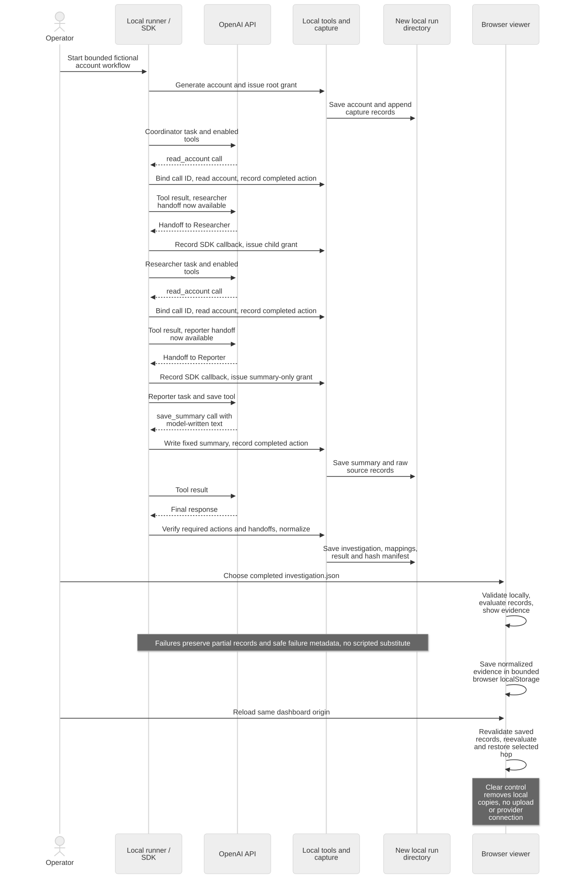
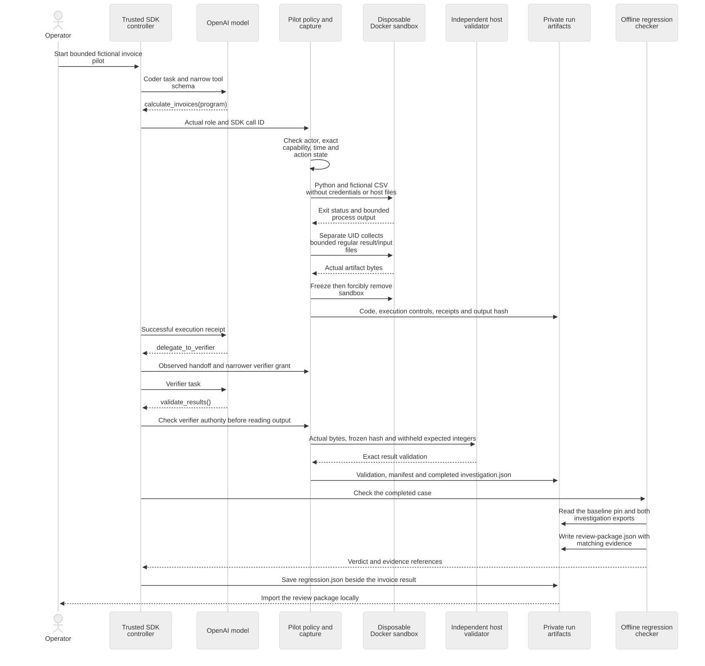

# Architecture

## Current system

The local viewer loads native HTML/CSS/JavaScript modules from a Python static server on IPv4 loopback. It evaluates fixed fictional examples or a manually selected version 1 completed-record export. File API intake is normalized and saved in origin-scoped browser localStorage across reloads. There is no data upload, writable backend, server database, cookie, authenticated session or provider connection from the browser.

The optional Python SDK runner produces an importable `investigation.json`. The separate Node experiment produces raw records and bare `normalized.json` for offline evaluation; it has no browser-import adapter. Neither process is launched by the dashboard.

Two offline Node commands read caller-selected files. The producer validator checks a completed investigation or a supported Codex or Agents SDK capture folder before handoff. The receiver verifier recomputes a portable Codex or invoice case in memory. A Codex resolution requires a matching independently supplied workflow pin. A previously closed invoice case can verify against its packaged baseline when the receiver has no pin. A conflicting receiver pin blocks both. [Producer validator](scripts/validate-capture.mjs) · [Receiver verifier](scripts/verify-case.mjs)

## C4 views

The [diagram guide](docs/architecture/README.md) links editable sources and rendering instructions. C4 containers here are applications/data stores, not Docker units or deployed services.

| Source | Owns |
| --- | --- |
| `src/index.html`, `src/styles.css` | Semantic shell, native chooser and responsive presentation |
| `src/app.js` | Chain, hop and run-pair selection, hash navigation, import state and escaped evidence rendering |
| `src/comparison.mjs` | Deterministic alignment, comparison and regression classification of two normalized runs |
| `src/import.mjs` | Bounded version 1 intake, normalization and imported-chain merge |
| `src/codex-import.mjs` | Offline pilot-folder manifest and tool receipt checks before version 1 normalization |
| `src/grant-lookup.mjs` | Resolve an action and its grant ancestry within the selected case snapshot |
| `src/storage.mjs` | Versioned, bounded browser-local imports and workflow baseline pins |
| `scripts/regression.mjs` | Offline baseline pinning and regression reports using the viewer's normalization and comparison rules |
| `src/review.mjs`, `src/review-view.mjs` | Report and package intake, local downloads, bounded inbox storage, review decisions and follow-up verification |
| `scripts/validate-capture.mjs` | Read-only producer diagnostics using the investigation parser, folder checks and authority evaluator |
| `scripts/verify-case.mjs` | Read-only receiver verification of portable Codex and invoice cases with the same checks as the inbox |
| `src/backup.mjs`, `src/backup-storage.mjs`, `src/backup-view.mjs` | Selects portable cases and pins, previews restore effects and coordinates writes to the browser’s three collections |
| `src/case-summary.mjs` | Builds a shareable text preview from the current disposition and bounded evidence references |
| `scripts/sdk-folder.mjs` | Validates the supported Agents SDK capture folder against its manifest, recorded tool calls and investigation |
| `scripts/build_codex_handoff.py` | Package generated fictional cases, independent pins and the separate reviewer and facilitator materials |
| `scripts/alpha-rehearsal.mjs` | Offline generation of fictional reviewer and facilitator materials with the regression checker |
| `src/fixtures.mjs` | Three fixed fictional investigations |
| `src/evaluator.mjs` | Pure deterministic retrospective authority checks |
| `scripts/serve.py` | Loopback static delivery, Host checks and public asset allowlist |
| `integrations/openai-agents/` | Optional actual model-agent execution, capture and export |
| `experiments/controlled-capture/` | Separate scripted local capture and negative branches |
| `experiments/sandbox-agent/` | Optional model-written invoice code, isolated Docker execution, runtime pilot policy and independent output validation |

## Records and evaluation

An export declares `schemaVersion: 1` and a `chain`; producers may add provenance. The viewer normalizes the chain and labels its source as an unverified claim rather than authenticating producer metadata. Chains identify a principal and root grant. Completed events identify actor, parent event, authority, exact action/resource and action time. Grants identify issuer, subject, principal, parent grant, capability pairs, validity window and delegation permission. Optional tool evidence includes call ID, tool and artifact hash. `src/import.mjs` is the exact field/limit contract.

Inputs are bounded to 1 MiB, 200 events, 200 grants and 100 capabilities per grant, with identifier/field-length limits. Duplicate IDs, malformed shapes, unsupported IDs, built-in `CH-` chain IDs and incomplete actions are rejected recoverably. Semantic gaps that pass intake remain evaluator evidence gaps. Imported strings are rendered literally and timestamps use a supported numeric ISO form.

`evaluateChain` independently limits direct callers to 200 events/grants, 100 capabilities per grant and the importer's security-field sizes. Only action/resource fields enter compared capability evidence. It charges a deterministic 50,000-unit budget for indexing, event/grant ancestry and capability validation/comparison. Finding identity uses nested maps/sets rather than full-array scans. At most 1,000 ordinary findings plus a reserved global `EVALUATION_LIMIT` finding are returned. On exhaustion, proven violations are retained, completeness is incomplete and all other displayable events are unknown. A limit is a partial assessment, not rejection of the supplied evidence or a clean authorization conclusion. The controller serializes repeated compared evidence only when its details are opened. These bounds control local work without adding a worker or changing the loopback asset boundary.

The pure evaluator reports `valid`, `violation` or `unknown`, completeness and per-event findings. The UI uses Within scope, Violation and Unverifiable. Event and grant ancestry are checked independently; record order never establishes lineage. Child authority must preserve identity/principal continuity, exact capabilities, delegation permission and narrower lifetimes. Each action must fall inside every ancestor's inclusive-start/exclusive-expiry window. Wildcards and prefixes have no special meaning. Invalid, missing, ambiguous or cyclic evidence cannot support a clean result. A separately provable violation remains visible beside other gaps. Results use recorded action time, independently of today's clock.

The comparison uses both runs' existing evaluations. It aligns events by exact record ID, then by unique actor and action/resource pair, then by unique remaining actor. Grants align by exact ID, then by unique subject/issuer/principal, then by unique remaining subject. Unmatched records appear on one side with their evidence, since an unmatched grant may be absent from the capture or lack a unique counterpart. The comparison uses recorded identities and never infers correspondence from array position.

Permissions compare exact capability pairs, delegation, principal, lineage and grant duration. For the known sandbox pilot, only each run's own execution and result targets are treated as equivalent across captures. Raw resource names, dates, call IDs and artifact hashes remain available in expanded records. The view compares recorded actions and parent references, evidence fields, referenced grant presence, evaluator outcomes and finding-code counts. It uses the existing import limits and renders raw records on expansion.

Regression checks use the selected workflow's pinned baseline, the same aligned differences, and the candidate's evaluator result. A proved regression takes precedence over an evidence gap, and both types of reasons are shown when present. A candidate violation or widening of a matched grant flags a regression, as does a changed matched action/resource pair. Unmatched records, changes in authority lineage, and loss of previously supplied evidence require review. Optional evidence is required where the baseline supplied it. A change in call ID or a valid hash alone does not affect the verdict. Reasons link to the compared row or the candidate hop.

## Local producer and receiver commands

The producer validator accepts a version 1 investigation file, the supported flat Codex folder or the account-review folder written by the repository’s Agents SDK runner. It checks the file shape and size before evaluating authority. For a folder, it also checks the manifest and tool receipts. A missing grant referenced by a valid action yields an unverifiable authority result. Changed receipt bytes fail the evidence check before an authority assessment can be made. Diagnostics identify the affected file, field or reference without printing receipt bodies.

The receiver verifier reads a receipt-inclusive portable Codex or invoice case. For invoices it reports authority, output integrity and execution separately, so a successful process exit cannot conceal changed output. [Four-case invoice exercise](docs/INVOICE_VERIFICATION.md) An optional, independently selected baseline directory contains the normalized investigation and its pin. The command recomputes the baseline fingerprint, checks its eligibility and imports the case into an in-memory inbox. The same assessment functions used by the dashboard recheck the original, follow-up, recorded closure and receiver pin. Output distinguishes a verified resolution, a case ready for explicit closure, a blocked case and invalid input. The process exits without changing the files, browser history or review decision. [Handoff and command examples](docs/CODEX_HANDOFF.md)

## Offline Codex run folder

The folder picker supports the disposable documentation-edit pilot capture.
Select the directory containing a flat `manifest.json` with a lowercase
SHA-256 digest for each of `actions.jsonl`, `grants.jsonl`, `attempts.jsonl`,
`before.md`, `after.md`, `quickstart.diff`, and `codex-events.jsonl`. The picker
uses top-level files only. File sizes are bounded, and each ledger can contain
up to 200 records.

ADCP checks all seven byte digests before normalizing the action and grant
records. Preflight and quickstart reads point to the before receipt, and the
paragraph edit points to the after receipt. Completed editor calls must match
the tool and call ID in the attempt ledger. Missing files and mismatches stop
the import. An omitted grant inside a verified ledger remains an authority
gap for the evaluator. Distinct verified captures have distinct run IDs.
The manifest establishes correspondence with the supplied files. Provenance and
capture completeness remain unverified.

The normal saved-run store keeps the normalized action, grant and receipt
references. The browser hashes the diff and Codex event stream at import time.
Keep the original capture for inspection of the file bytes.

After import, **Compare and save to inbox** checks the candidate against a named
workflow's pinned baseline. It verifies the baseline fingerprint and rejects a
candidate with the same run ID. The inbox stores both normalized runs, the
report, all seven manifest digests and exact bytes for the three ledgers and
the before/after Markdown files. The capture diff and Codex event stream are
represented by their import-time digests.

Reopening the entry rehashes the five retained files, verifies the tool
receipts, reconstructs the candidate and compares both runs with the saved
report fingerprints. The reviewer can inspect a missing grant at each affected
action and save a decision about the gap.

A reviewer can attach a corrected folder directly to the flagged inbox entry.
It must have a distinct run ID and match the original preflight actor,
repository resource, and starting document digest. The importer verifies all
seven files again and keeps the same five receipt files for the follow-up.
Both snapshots count toward the 2 MiB inbox limit.

**Close as resolved** requires the original flagged result to reproduce, the
follow-up to pass against the saved baseline, and the workflow's current pin to
match the original run ID and fingerprint. Closure records the case, decision,
and follow-up together. Reopening the case rechecks both snapshots and the
current pin. A conflicting pin leaves the case open and preserves that pin.
A standard Codex case download carries the original normalized evidence and
saved decision. **Include Codex receipts in case download** produces a version 1
`adcp-codex-review-case` file containing the five retained files and seven
digests for the original and any attached, verified follow-up. An explicitly
closed case includes its closure fingerprint when the exporter’s current pin
still matches. The note has a separate export option.

Import and reload recheck the evidence and compare the recipient’s workflow pin
with the packaged baseline ID and fingerprint. A missing pin leaves the case
open. After inspecting the included baseline, the recipient can pin it to save
that investigation locally and recheck the recorded closure. A conflicting pin
is preserved. Without a verified closure record, even a passing follow-up stays
open until a reviewer closes it. An altered receipt is identified on the
affected side and prevents closure. The package uses the existing 2 MiB limit.

The Codex closure checklist uses the current evidence and pin checks each time
an open case is displayed. A failed receipt names its capture and file when
available. Checklist navigation opens evidence or moves focus to an existing
control. Pin adoption, attaching a corrected folder, and closing the case each
require their own reviewer action.

For an original Codex receipt that fails verification, a reviewer can select a
receipt-inclusive export of the same case. Preview checks the original report,
workflow, baseline and candidate investigations, and receipt snapshot against
the saved case. It lists the original files whose bytes would be restored.
Applying the preview rechecks the match before writing to the existing inbox
entry. The local pin, decision, notes and attached follow-up are preserved.
Repair clears any recorded closure. Closing again requires a verified follow-up,
the matching local pin and an explicit reviewer action.

**Local repair history** is stored with each Codex inbox case. Applying a repair
records the time, each changed file, the SHA-256 of its previous bytes and the
verified replacement digest. A missing or unreadable previous file is labeled
accordingly. Explicit closure records its own time and the run IDs and
fingerprints of the pinned baseline and passing follow-up. Each action and its
history entry share one inbox write. When the case reopens, the dashboard
verifies its current evidence and pin independently of this history.

Receipt-inclusive Codex cases can optionally carry sender-reported history.
The export includes repairs recorded in the exporting profile and explicit
closures for the attached follow-up. The recipient stores eligible events
separately from local history, with the original case identifier. A repair’s
replacement digest must match the recorded manifest. Closure references must
match the baseline and follow-up in the case. The earlier digest and times are
sender claims. The optional field supplies context for review. Import and
reload use the existing receipt, pin, follow-up and resolution checks to decide
whether the case is resolved.

## Optional actual-agent workflow

The caller-owned Python SDK loop runs Coordinator → Researcher → Reporter. Each role completes one fixed local tool action. Handoffs become available only after the current role finishes its action; repeated role tools are disabled. Tools accept no arbitrary file paths. The first two roles read generated fictional account data; Reporter writes a model-generated summary to a fixed file. Root/research grants include read and summary-write authority; the reporter grant narrows to summary write without further delegation.

SDK callbacks and tools bind model call IDs, role, parent action, local grant, source line and artifact hash. These are application-issued bindings, not cryptographic identities or external IAM. The runner reads ignored project-root `.env.local` and exchanges fictional tasks/results with OpenAI over HTTPS. Trace export is disabled and response storage requested off. Limits are ten turns/requests, 1200 output tokens per request, a 35-second provider timeout and 150 seconds overall, with no provider retries. These are execution bounds, not a monetary price.

A new run directory stores account data, capture, normalized investigation, mappings, summary, result and a hash manifest. Its parent must exist; existing output directories are refused. Failed runs retain safe failure metadata and partial capture, with no scripted substitute. Hashes establish byte correspondence, not authenticity or complete capture. Setup and exact versions are in the [integration guide](integrations/openai-agents/README.md).

## Optional sandboxed coding pilot

This path has been exercised: three live Coder → Verifier runs passed exact
fictional-invoice output checks. Their saved programs also passed the final
hardened executor without more provider calls. The [validation report](docs/SANDBOX_VALIDATION.md)
records observed outcomes, the hardening chronology, real-container negative
controls and the limits of that evidence. The diagrams describe the current
implementation; the report identifies what was actually tested.

The separately invoked pilot retains the caller-owned Agents SDK loop and model.
Coder calls one fixed invoice-calculation tool with Python text, then hands off to
Verifier, whose fixed tool checks downloaded result bytes against withheld expected
integers. These are actual SDK role/tool/handoff bindings. A host-owned pilot policy
checks actor, exact action/resource, validity, call ID and completed-role state before
each action. It is a narrow execution gateway, separate from the retrospective viewer.

Every execution creates a disposable Docker container with no host mounts, ports,
network, API key or repository; read-only root, non-root job, dropped capabilities,
no-new-privileges and explicit CPU/memory/process/output/time/file limits apply. A
4 MiB tmpfs holds fictional input, generated code and output. A separate non-root
collector UID reads only bounded regular result/input files; the host never extracts
the archive. The original input must be unchanged, and the actual result must pass
integer/schema/hash checks. Containers are removed after collection or failure.

Completed actions use the existing version 1 envelope and evaluate independently.
Denied attempts, execution failures, business-result grading and capture/hash checks
have separate receipts; they are not represented as completed actions. Missing or
over-granted evidence is mutated only in explicitly derived offline tests. No general
grant service, authenticated principal, signed evidence or sandbox-escape resistance
is established. See the [pilot guide](experiments/sandbox-agent/README.md) for exact
limits, repeatability and cleanup boundaries.

After the pilot writes a completed investigation and its manifest, the host runs the
offline Node checker. The checker reads a separately pinned baseline and the completed
export, reuses the viewer's fingerprint, evaluator and comparison rules, and returns a
verdict with affected event or grant IDs. The checker can write `review-package.json`
using the same in-memory evidence it checked. The pilot saves `regression.json`
separately and records package creation in the case result. The evidence manifest
covers the capture files written before the check. Missing, altered or unusable
inputs require review. The checker reads local files and uses no model or Docker
calls. Browser pins and command-line pins are managed separately.

The browser can also check a selected invoice case folder in the regression inbox.
It hashes the original bytes of six allowlisted files against the supplied manifest.
Authority reuses the delegation evaluator. Output checks the totals against the
expected values and validation receipt, and binds the output digest to both
completed actions. Execution reports completion, exit code, input preservation,
cleanup and attempt counts from matching receipts. Each lane reports its own
result. The importer reads only allowlisted receipt files. The manifest is unsigned.

The inbox can compare the selected folder's matching investigation against the
exact saved workflow pin. Saving records the report, baseline and candidate,
relevant manifest digests, and original receipt bytes in one bounded inbox write.
The receipt snapshot fingerprint distinguishes copies with the same run ID and
different files. Opening the entry recomputes the comparison from the saved
runs and verifies the saved receipt bytes.

A failing invoice receipt check can open a review case alongside a passing
baseline comparison. Invoice follow-ups use the case's original baseline
snapshot and require its workflow pin when attaching or closing. A correction
can use the original run ID when the investigation fingerprint matches. Closure
binds the decision and follow-up snapshot to the original case and is rechecked
against saved baseline, authority, output, and execution evidence on reopen.
Ordinary invoice case downloads carry the original delegation report and decision.
With explicit receipt opt-in, a version 1 `adcp-invoice-review-case` includes the
allowlisted receipt snapshots and the matching follow-up. Import rechecks the
packaged baseline and both invoice snapshots, and verifies the closure fingerprint
before restoring resolution. A conflicting local workflow pin leaves the imported
case open. Imports leave workflow pins unchanged.

## Trust and recovery

The static server permits the dashboard HTML, styles and JavaScript modules on an explicit [asset allowlist](scripts/serve.py). It rejects writes, unexpected Hosts and repository paths. Its content policy blocks outbound browser connections. Loopback is a development boundary, not authentication. Run artifacts and credentials are not served.

Imports are stored under `adcp.investigations.v1` as versioned normalized envelopes, with a 20-run / 2 MiB UTF-8 serialized collection limit in addition to per-import limits. Each saved envelope passes intake again on startup and findings are recomputed with the current evaluator before hash selection, so a chain/hop URL can reopen its saved evidence. Findings are never trusted from storage. Reimport replaces the same chain ID; writes merge against the latest saved collection to preserve imports from other tabs. Current dashboard tabs serialize saved-data changes with a common Web Lock where supported. A selective inbox restore requires that lock and temporarily journals the original collections in `adcp.pending-backup-restore.v1`. Other current tabs read the previous values until commit. Startup rolls back interrupted restores before opening the collections. Older dashboard versions do not participate in this protocol. [Inbox backup and recovery](docs/INBOX_BACKUP.md)

Users name workflows explicitly. A separate, versioned browser store holds up to 20 workflow names, run IDs and SHA-256 fingerprints of the selected normalized runs, capped at 12 KiB. The viewer checks a pin against the loaded record before reporting a regression verdict. Reimporting changed evidence under the same run ID cannot silently move the baseline. Clear imported runs leaves pins available for reimport of the original records, and users can remove pins independently. A fingerprint identifies the saved record and does not authenticate its producer. Reload the view to pick up records imported in another tab.

An eligible imported run can be pinned from its investigation or from Compare runs. Both views use the same save operation. Repeating the same pin preserves it. Replacing a different run or fingerprint requires confirmation showing the workflow, both run IDs and both fingerprints. If the stored pin changes before the save, the viewer asks the reviewer to check the current baseline again.

The review inbox stores up to 20 reports and 2 MiB total under `adcp.regression-reviews.v1`. Each item has the normalized report, optional matching evidence snapshots, a note and a reviewed flag. Attachments must match both run ID and fingerprint. Opening an item rechecks the snapshots and recomputes findings with the current evaluator when both exports qualify. The recorded verdict and current result remain distinct. The action directory and flagged findings link to a case, snapshot side and event. Grant lookup follows exact parent IDs in that same matching snapshot and preserves the selected action on reload. Evidence drill-down stays within the saved snapshots, even when a normal run import with the same ID changes. Report input does not supply navigation targets. Reimporting the same report preserves its note and matching snapshots, and updates save the report, evidence and note together under one key. The inbox has its own removal control.

The optional Codex import preview simulates a fresh import into a temporary in-memory overlay. It shows included receipt filenames, accepted sender-history count, required baseline identity, receiver pin state and prospective disposition. Canceling discards the preview. Confirming rechecks the input, current pin, duplicates and available inbox space before saving. A failed confirmation leaves existing cases intact. The original one-step import remains available.

The inbox rechecks each saved case before showing its closure and first blocker.
Workflow, decision and closure filters apply to these current results. A selected
case remains inspectable when a changed pin moves it outside the active filter.
The tab remembers only the three filter choices in session storage. Other tabs’
changes to evidence or pins trigger a new check. An invoice’s self-contained
portable closure can verify when the receiver has no pin. A conflicting or
unreadable pin prevents displaying or exporting a verified resolution.

A portable package is a version 1 JSON document capped at 2 MiB. It wraps the normalized report, optional matching version 1 investigation envelopes and an optional note. Imports use the same fingerprint checks as separate files. An altered attachment is excluded and marked as mismatched. Exports use a browser-local download, omit the note by default and leave review completion local to each inbox. An included note seeds a newly imported item. Existing local reviews take precedence on reimport.

An inbox case can save a decision with its reason and one current follow-up. The follow-up must reference the original baseline ID and fingerprint and provide matching baseline and candidate exports. Its candidate must have a distinct run ID. The inbox stores the follow-up report and candidate snapshot and reuses the original baseline snapshot. A case can resolve only when the original check still flags the case, both evidence pairs verify, and the reported and recomputed follow-up verdicts pass. Resolution points to the saved follow-up and is verified again when the case opens.

A version 1 `adcp-review-case` file uses the same 2 MiB limit and adds the decision,
matching follow-up report and candidate, and a closure fingerprint when verified
on export. It binds the original report, decision, and follow-up. Import derives
local report IDs and rechecks both evidence pairs before
restoring closure. A case import writes once and preserves any existing local
decision and follow-up. Fingerprints let the browser check the supplied records
against their reports. They provide no proof of authorship.

Unreadable collections leave examples usable; malformed individual records are skipped with a visible warning and are never silently overwritten on save. Capacity, quota or denied-storage failures leave the new import available only in the current tab with a warning. No run is automatically evicted. **Clear imported runs** removes only this application key and the current tab's imports; other open tabs retain loaded copies until reload. Original export files remain unchanged. Browser site-data deletion or storage eviction can remove saved runs, and changing browser profile, host or port selects different storage. This is local convenience storage, not a backup or shared evidence service. Stop processes to end execution and preserve run directories for diagnosis. Use a new directory for a new attempt. Read the [threat model](docs/architecture/THREAT_MODEL.md) and [privacy guidance](docs/PRIVACY.md) before sharing records.

No general live ingestion, verified external authority, revocation processing, shared durable state, action prevention, MCP/A2A conformance or production reliability is established. New capabilities require their own architecture and evidence contracts.

A selective backup carries chosen portable cases and optional workflow pins. Folder receipts, notes and sender history require explicit selection. Restore previews skip existing cases, protect conflicting pins, and show the result of selected pins. Before committing, restore rechecks the saved state while holding the dashboard write lock. A rollback record covers the run, pin and inbox collections so a failed or interrupted restore can recover the previous view. Close older dashboard tabs before restoring. [Backup and recovery](docs/INBOX_BACKUP.md)

## Reviewer handoff and producer signatures

A reviewer can preview and copy plain text for a pull request. The summary includes the current disposition, a relevant grant or missing reference, receipt digests when available and the next review action. Copy rechecks the case so a changed pin cannot silently carry an earlier result into the clipboard. The reviewer chooses where to paste the text. [Summary and privacy](docs/PRIVACY.md#sharing-a-pr-summary)

A separate offline experiment verifies a producer signature over the exact case bytes, issuer, workflow and run. The verifier obtains trust from a receiver-owned key list. A trusted producer can still sign a case with a broken receipt. Case assessment checks the records independently. [Signature experiment and threat model](experiments/receipt-provenance/README.md)

## Development safeguards

CI uses commit-pinned actions and a read-only repository token. The project integrity job exercises the application, CLI, SDK replay and isolated execution. The security job checks the source for secret patterns and Python findings and checks pinned Python dependencies against advisories. Dependabot monitors the workflow actions, Python dependencies, browser test package and pilot Dockerfile. The optional pre-commit hook scans the staged bytes. [Contributing](CONTRIBUTING.md)

The separate Chromium job builds and extracts the fictional handoff ZIP, starts the dashboard on loopback, and uses fresh browser contexts for sender and receiver. It drives file selection, repair, explicit closure, reload and onward export. Browser expectations and offline verifier tests use the same facilitator outcomes. Unexpected external browser requests fail the tests. The browser and driver are installed only for acceptance testing. [CI workflow](.github/workflows/project-integrity.yml) · [Browser acceptance tests](tests/browser/README.md)
