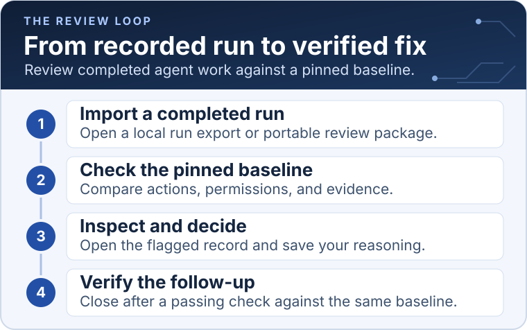
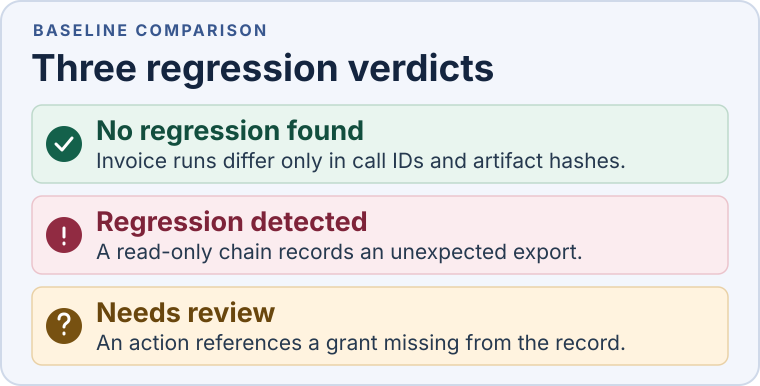

# Agent Delegation Control Plane

Review **who acted for whom, which grant covered the action, and what changed between runs**. This local dashboard helps security and platform engineers investigate completed agent workflows, triage regressions, and verify follow-up evidence.

**Public technical alpha** · [v0.1.0-alpha.6](https://github.com/zrack/agent_delegation_control_plane/releases/tag/v0.1.0-alpha.6) · [Roadmap](ROADMAP.md)

## Run locally

Requires **Python 3.11+**. From the repository root:

```sh
python3 scripts/serve.py
```

Open [the local dashboard](http://127.0.0.1:48731/). Stop with `Ctrl+C` or choose a different port with `--port 48732`. The dashboard uses the browser and the Python standard library.

## Try the portable invoice review demo

1. Extract **Source code (zip)** from [v0.1.0-alpha.6](https://github.com/zrack/agent_delegation_control_plane/releases/tag/v0.1.0-alpha.6).
   Start the dashboard from the extracted source. Extract the
   [portable invoice review demo ZIP](https://github.com/zrack/agent_delegation_control_plane/releases/download/v0.1.0-alpha.6/adcp-portable-invoice-review-demo-v0.1.0-alpha.6.zip) separately.
2. In a fresh browser profile, open **Regression inbox → Import review package
   or case**. Import the two resolved JSON files below, one at a time.
3. Open each entry, check its decision and status, and reload at the same
   address to verify that both return. Use another fresh profile or a different
   loopback port for the two **Open** variants, then repeat the import and reload
   checks. The inbox preserves existing local decisions and follow-ups on reimport.

| Case file | Expected status after reload | What to verify |
| --- | --- | --- |
| `invoice-b-resolved.json` | **Resolved** | Missing validation receipt in the original case. Corrected follow-up verifies 1,231 cents. |
| `invoice-c-resolved.json` | **Resolved** | Altered output in the original case. Corrected follow-up verifies 2,441 cents. |
| `invoice-b-altered-receipt.json` | **Open** | Follow-up output changed after export. Closure verification fails. |
| `invoice-c-different-baseline.json` | **Open** | The packaged baseline differs from the original. Closure verification fails. |

Under **Inspect follow-up evidence**, expand **File checks against manifest**.
All six files should match in the corrected follow-ups. For the altered variants,
check the import warning and confirm **Close as resolved** is disabled.
[Full alpha walkthrough](docs/ALPHA_REVIEW.md#try-the-portable-invoice-review-demo)

## Inspect records

Start with the three built-in examples or select **Import a completed run** to open a version 1 `investigation.json`. Choose an agent hop to inspect its recorded action, grant, parent grant, and findings.

| Built-in example | What to inspect | Authority assessment |
| --- | --- | --- |
| CH-001 · Account review | Grants narrow at every hop | Within scope |
| CH-002 · Unexpected export | The final action exceeds upstream read authority | Violation |
| CH-003 · Missing authority | Hops 2 and 3 depend on a missing grant | Unverifiable |

## Review a regression



1. **Compare two runs.** In **Compare runs**, select a baseline and candidate from the same workflow. Open permission, action, or evidence differences to see both records. To reuse a baseline, choose a within-scope run with complete authority evidence and save it under a workflow name.
2. **Review a package.** In **Regression inbox**, use **Import review package or case** to open a `review-package.json` or `review-case.json`. **Import a report** also accepts a separate `regression.json` with its evidence exports. Matching fingerprints let the inbox reproduce the verdict locally. Save a review note and, for a flagged case, record a decision and reason.
3. **Verify the follow-up.** Attach a package with both matching exports, the original pinned baseline, and a new candidate run ID. Compare the original and follow-up verdicts. **Close as resolved** requires a passing follow-up report and a passing local recheck.



Open **Export review package or case** to see what each download includes. The review package contains the original report and matching evidence. The review case can also carry the saved decision, reason, and matching follow-up. Import restores **Resolved** only after the browser rechecks the original and follow-up against the same baseline. Existing local decisions take precedence, and notes are included only when selected. [Privacy and sharing guidance](docs/PRIVACY.md)

To try a saved decision and verified closure, follow the [resolved case exercise](docs/ALPHA_REVIEW.md#import-a-resolved-case).

## Try the alpha rehearsal kit

Generate the full rehearsal kit with **Node 22+**:

```sh
node scripts/alpha-rehearsal.mjs
```

Open `output/private-alpha-rehearsal/reviewer/` for six ready-to-import fictional packages and the task sheet. The separate `facilitator/` folder contains the answer key. If the output already exists, select a new directory with `--output`. [Alpha rehearsal guide](docs/ALPHA_REVIEW.md)

## Architecture and limits

The evaluator uses recorded action time to check ancestry, identity continuity, permission to delegate, exact action and resource pairs, and grant validity windows. A proven violation remains visible beside evidence gaps. Identities and source claims are self-reported. The dashboard serves allowlisted files on IPv4 loopback and evaluates completed actions locally.

Imported runs and the review inbox each hold up to 20 entries or 2 MiB in this browser. An individual run import can be up to 1 MiB with 200 events and 200 grants. Baselines pin an exact run ID and fingerprint. Browser storage is scoped to the profile and dashboard address. [Architecture](ARCHITECTURE.md) · [C4 and sequence diagrams](docs/architecture/README.md) · [Threat model](docs/architecture/THREAT_MODEL.md)

Optional workflows run separately from the viewer. The [Agents SDK example](integrations/openai-agents/README.md) captures a Coordinator → Researcher → Reporter workflow. The [invoice pilot](experiments/sandbox-agent/README.md) executes model-written Python in Docker, checks physical output, and produces a regression report and review package. Three live Coder → Verifier runs validated the fictional invoice outputs. Live invocations require provider access and may consume credits. The [scripted experiment](experiments/controlled-capture/README.md) covers the three authority outcomes offline. [Observed sandbox validation](docs/SANDBOX_VALIDATION.md)

## Check locally

```sh
python3 scripts/check.py
```

The standard check runs offline tests with Node 22+ and briefly binds a loopback port. Use `--with-sdk` with the pinned SDK environment to include two offline replay tests. With the pilot image built and Docker running, use `--with-sdk --with-sandbox` for the full suite. GitHub also runs dependency advisory and source security checks. [Contributing](CONTRIBUTING.md)

Report vulnerabilities through [GitHub’s private reporting form](https://github.com/zrack/agent_delegation_control_plane/security/advisories/new). See the [security policy](SECURITY.md) for what to include.

[Release readiness](docs/RELEASE_READINESS.md) · [Apache-2.0 license](LICENSE) · [Rights](RIGHTS.md) · [Third-party notices](THIRD_PARTY_NOTICES.md)
