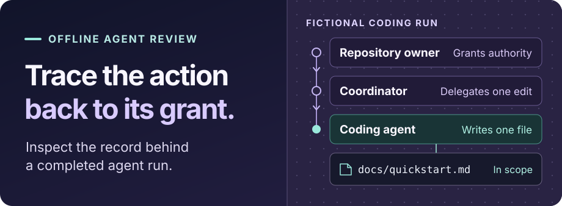
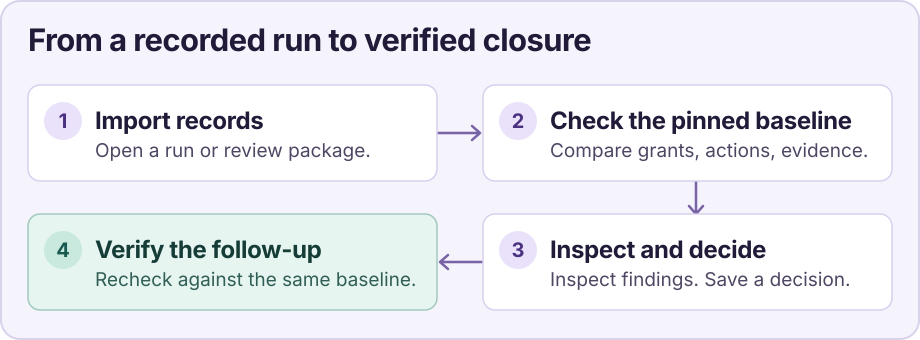
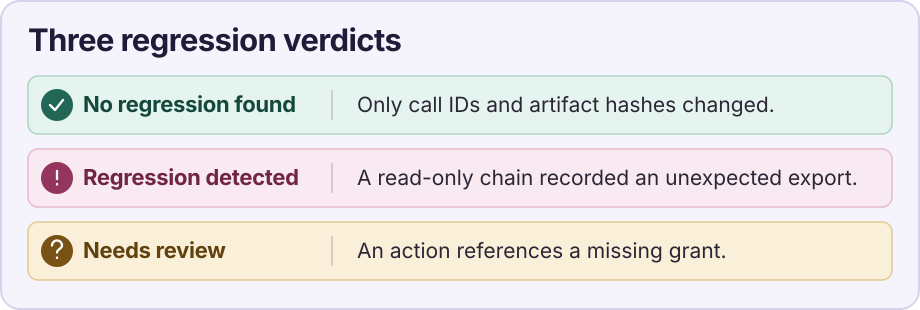
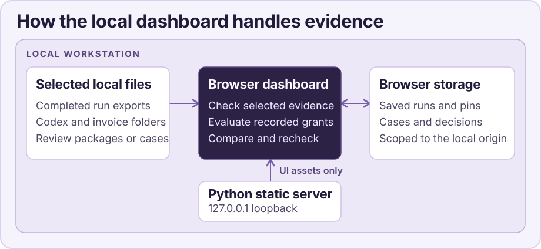

# Agent Delegation Control Plane

Review **who acted for whom, which grant covered the action, and what changed between runs**. This local dashboard helps security and platform engineers investigate completed agent workflows, triage regressions, and verify follow-up evidence.

**Public technical alpha** · [v0.1.0-alpha.16](https://github.com/zrack/agent_delegation_control_plane/releases/tag/v0.1.0-alpha.16) · [Roadmap](ROADMAP.md)

**Participating in the two-reviewer pilot?** Start with `START.md` in the packet your facilitator gave you. Save the public walkthrough for after your session.



To try the **Codex reviewer handoff** on your own, take the receiver’s side of a fictional quickstart edit. Can you trace the editor’s grant and decide whether the case should be closed? [Download the alpha.16 handoff ZIP](https://github.com/zrack/agent_delegation_control_plane/releases/download/v0.1.0-alpha.16/adcp-codex-handoff-demo-v0.1.0-alpha.16.zip) · [Follow the exercise](#review-a-codex-handoff)

## Run locally

Download **Source code (zip)** from the [alpha.16 release](https://github.com/zrack/agent_delegation_control_plane/releases/tag/v0.1.0-alpha.16). Extract the source and demo ZIPs into separate folders. From the source directory, start the dashboard with **Python 3.11+**.

```sh
python3 scripts/serve.py
```

Open [the local dashboard](http://127.0.0.1:48731/). Stop with `Ctrl+C` or choose a different port with `--port 48732`. The dashboard uses the browser and the Python standard library.

## Review a Codex handoff

Open `reviewer/TASK_SHEET.md` in the extracted demo. The seven scenarios share a case ID, so use a fresh Chromium profile for each. Start with the first row.

1. **Choose your baseline.** In **Investigate a run → Import a Codex run folder**, choose `pins/matching`. In **Compare runs**, select the imported run as **Baseline run**. Expand **Save or replace a workflow baseline**, name it `Follow-up review` and select **Save baseline**.
2. **Open the handoff.** In **Regression inbox → Import review package or case**, choose `cases/history-on.json`. Reload at the same address and reopen the case.
3. **Explain your decision.** Compare the digest for `after.md` in **Sender-reported history** with the saved original output receipt. Find the editor’s grant in the follow-up’s `grants.jsonl`. Which evidence supports the status you see after reload?

**Running from the current source checkout?** You can pin an eligible run directly after import. Check the run ID, enter `Follow-up review` as the workflow name and select **Pin this run as a workflow baseline**. If that workflow already points to different evidence, review both pins before choosing **Replace baseline** or **Cancel**. The alpha.16 download uses the **Compare runs** steps above.

Try `cases/history-off.json` with the same baseline in a second fresh profile. Record what you can verify about closure and what you can establish about the repair. Then compare your answers with the walkthrough. [All seven scenarios and expected results](docs/ALPHA_REVIEW.md#review-a-codex-handoff) · [Verify a case offline](docs/CODEX_HANDOFF.md#verify-the-case-offline)

### Run the two-reviewer pilot

Give each reviewer their own packet. Both review the same seven cases, with opposite assignments for manual review and the dashboard. Time setup separately. For each decision, record the reason and the evidence the reviewer cites, where they needed help, and any incorrect closure action. Keep the answer key and observations with the facilitator. [Prepare the two packets](docs/CODEX_HANDOFF.md#compare-ordinary-review-with-the-dashboard) · [Facilitator and scoring guide](docs/reviewer-pilot/FACILITATOR.md)

<a id="try-the-portable-codex-review-demo"></a>

## Review the repair history of a Codex case

To perform the repair yourself, use the earlier alpha.15 exercise. Preview a replacement for `after.md`, check both digests after reload, and review the corrected grant before closing. [Alpha.15 repair history ZIP](https://github.com/zrack/agent_delegation_control_plane/releases/download/v0.1.0-alpha.15/adcp-codex-repair-history-demo-v0.1.0-alpha.15.zip) · [Repair walkthrough](docs/ALPHA_REVIEW.md#repair-an-original-codex-receipt)

### Try the Codex run-folder demo

To build the case from the original capture and attach the corrected folder yourself, follow the [run-folder walkthrough](docs/ALPHA_REVIEW.md#try-the-codex-run-folder-demo).

## Try the coding-agent review demo

Review an out-of-scope edit and a missing grant, then check whether each corrected follow-up supports closure against the original baseline. [Alpha.8 four-case ZIP](https://github.com/zrack/agent_delegation_control_plane/releases/download/v0.1.0-alpha.8/adcp-coding-agent-review-demo-v0.1.0-alpha.8.zip) · [Coding-agent walkthrough](docs/ALPHA_REVIEW.md#try-the-coding-agent-review-demo)

## Try the portable invoice review demo

Inspect the receipts for two corrected invoices, then see how an altered output or a different baseline affects closure after reload. The walkthrough lists the files, expected totals and checklist results for all four cases. [Alpha.7 invoice ZIP](https://github.com/zrack/agent_delegation_control_plane/releases/download/v0.1.0-alpha.7/adcp-invoice-closure-checklist-demo-v0.1.0-alpha.7.zip) · [Invoice walkthrough](docs/ALPHA_REVIEW.md#try-the-portable-invoice-review-demo)

## Inspect records

Start with the three built-in examples or select **Import a completed run** to open a version 1 `investigation.json`. Choose an agent hop to inspect its recorded action, grant, parent grant, and findings.

Validate a producer record locally before importing it. The [producer walkthrough](docs/producer/README.md) includes a minimal example, a missing grant and a malformed field.

For other captures in the same format, see the
[pilot folder format](ARCHITECTURE.md#offline-codex-run-folder).

| Built-in example | What to inspect | Authority assessment |
| --- | --- | --- |
| CH-001 · Account review | Grants narrow at every hop | Within scope |
| CH-002 · Unexpected export | The final action exceeds upstream read authority | Violation |
| CH-003 · Missing authority | Hops 2 and 3 depend on a missing grant | Unverifiable |

## Review a regression



1. **Compare two runs.** In **Compare runs**, select a baseline and candidate from the same workflow. Open permission, action, or evidence differences to see both records. To reuse a baseline, choose a within-scope run with complete authority evidence and save it under a workflow name.
2. **Review a package.** In **Regression inbox**, use **Import review package or case** to open a `review-package.json` or `review-case.json`. **Import a report** also accepts a separate `regression.json` with its evidence exports. Matching fingerprints let the inbox reproduce the verdict locally. Save a review note and, for a flagged case, record a decision and reason.
3. **Verify the follow-up.** Attach a package with both matching exports, the original pinned baseline, and a new candidate run ID. Compare the original and follow-up verdicts. **Close as resolved** requires a passing follow-up report and a passing local recheck.

You can preview a case summary before copying it into a pull request, move cases and pins to another profile, or verify a portable invoice case offline. [What the summary shares](docs/PRIVACY.md#sharing-a-pr-summary) · [Inbox backup and restore](docs/INBOX_BACKUP.md) · [Invoice verification](docs/INVOICE_VERIFICATION.md)



Open **Export review package or case** to see what each download includes. The review package contains the original report and matching evidence. The review case can also carry the saved decision, reason, and matching follow-up. Import restores **Resolved** only after the browser rechecks the original and follow-up against the same baseline. Existing local decisions take precedence, and notes are included only when selected. [Privacy and sharing guidance](docs/PRIVACY.md)

To try a saved decision and verified closure, follow the [resolved case exercise](docs/ALPHA_REVIEW.md#import-a-resolved-case).

## Try the alpha rehearsal kit

Generate the full rehearsal kit with **Node 22+**:

```sh
node scripts/alpha-rehearsal.mjs
```

Open `output/private-alpha-rehearsal/reviewer/` for six ready-to-import fictional packages and the task sheet. The separate `facilitator/` folder contains the answer key. If the output already exists, select a new directory with `--output`. [Alpha rehearsal guide](docs/ALPHA_REVIEW.md)

## Architecture and limits



The evaluator uses recorded action time to check ancestry, identity continuity, permission to delegate, exact action and resource pairs, and grant validity windows. A proven violation remains visible beside evidence gaps. Identities and source claims are self-reported. The dashboard serves allowlisted files on IPv4 loopback and evaluates completed actions locally.

Imported runs and the review inbox each hold up to 20 entries or 2 MiB in this browser. An individual run import can be up to 1 MiB with 200 events and 200 grants. Baselines pin an exact run ID and fingerprint. Browser storage is scoped to the profile and dashboard address. [Architecture](ARCHITECTURE.md) · [C4 and sequence diagrams](docs/architecture/README.md) · [Threat model](docs/architecture/THREAT_MODEL.md)

Optional workflows run separately from the viewer. The [Agents SDK example](integrations/openai-agents/README.md) captures a Coordinator → Researcher → Reporter workflow. The [invoice pilot](experiments/sandbox-agent/README.md) executes model-written Python in Docker, checks physical output, and produces a regression report and review package. Three live Coder → Verifier runs validated the fictional invoice outputs. Live invocations require provider access and may consume credits. The [scripted experiment](experiments/controlled-capture/README.md) covers the three authority outcomes offline. [Observed sandbox validation](docs/SANDBOX_VALIDATION.md)

## Check locally

```sh
python3 scripts/check.py
```

The standard check runs offline tests with Node 22+ and briefly binds a loopback port. Use `--with-sdk` with the pinned SDK environment to include offline SDK replay and capture checks. With the pilot image built and Docker running, use `--with-sdk --with-sandbox` for the full suite. GitHub also runs dependency advisory and source security checks. [Contributing](CONTRIBUTING.md)

Report vulnerabilities through [GitHub’s private reporting form](https://github.com/zrack/agent_delegation_control_plane/security/advisories/new). See the [security policy](SECURITY.md) for what to include.

[Release readiness](docs/RELEASE_READINESS.md) · [Apache-2.0 license](LICENSE) · [Rights](RIGHTS.md) · [Third-party notices](THIRD_PARTY_NOTICES.md)
